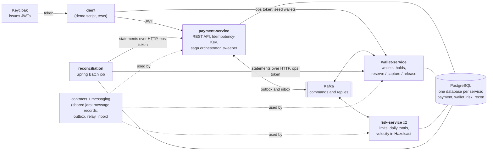

# PayFlow

Three Spring Boot services take each payment through a saga over Kafka (hold the money, check risk, capture) and end
it `COMPLETED`, `REVERSED` (any hold returned before capture; there are no refunds) or `REJECTED`. The chaos tests
kill a service or a risk member, pause payment-service or restart the Kafka broker in the middle of a batch, and found
no money lost or moved twice in the runs below.

[](LICENSE)
[](.github/workflows/ci.yml)
[](https://github.com/TheSiddheshFulawade/payflow/releases)

Open source (MIT). Nothing is hosted: you run it on your own machine with Docker Compose. The requirements, design and
tasks are in [SPEC.md](SPEC.md).

## What is checked

After every system and chaos run, `InvariantChecker` reads the databases and checks six invariants over the payments
and wallets of that run
([InvariantChecker.java](system-tests/src/test/java/com/siddheshfulawade/payflow/system/invariants/InvariantChecker.java)):

1. **Money is conserved.** The sum of `available + held` over the run's wallets equals what was seeded.
2. **Nothing stays held.** The sum of `held` is 0 once every payment has ended.
3. **Every payment ends.** Each one is `COMPLETED`, `REVERSED` or `REJECTED`; none is left in a middle state.
4. **A completed payment moved money exactly once.** It has exactly one debit of the payer's held balance and one credit
   of the payee's available balance, both of the payment amount. Fewer would be a lost capture, more a double charge.
5. **A reversed or rejected payment moved no money.** No capture, and every hold was released.
6. **One payment per (client, `Idempotency-Key`).** A request sent again by the same client with the same key creates no second payment (the
   checker); the test harness also checks that every copy got the same payment id.

Each chaos test also asserts the exact number of payments in each final state, because a fault that turned a refusal
into a completion would keep the money consistent and pass the invariants alone.

Below the system tests: jqwik properties drive the real saga state machine against a model wallet, risk service and a
network that loses, duplicates, reorders and delays messages, and check after every step that a payment ends once and
is captured at most once
([SagaModelPropertyTest](payment-service/src/test/java/com/siddheshfulawade/payflow/payment/domain/SagaModelPropertyTest.java)).
The database guards the money as well: balances have `CHECK (>= 0)`, and a unique index on `(payment_id, kind)` stops a
payment from writing the same ledger movement twice.

Passing tests show that no violation was found in those runs. They are not a formal proof.

## Results

**Chaos scenarios C1 to C5.** Each sends a batch of 40 payments from 10 payers with a known mix of outcomes and
injects its fault once 20 requests are accepted (half the batch; in C5, 20 of the 120 copies; in C3 the 7 extra
payments are sent after the kill)
([ChaosSystemTest.java](system-tests/src/test/java/com/siddheshfulawade/payflow/system/ChaosSystemTest.java)).
Then every payment must end within 3 minutes and all six invariants must hold. They did, in every run below.

| Scenario | Fault | Payments | COMPLETED / REVERSED / REJECTED | Laptop | GitHub runner |
| -------- | ----- | -------- | ------------------------------- | -----: | ------------: |
| C1 | wallet-service killed, restarted after 5 s | 40 | 15 / 5 / 20 | 49 s | 49 s |
| C2 | Kafka broker restarted | 40 | 15 / 5 / 20 | 11 s | 10 s |
| C3 | risk-1 killed; risk-2 alone, plus 7 payments from one payer | 47 | 20 / 7 / 20 | 50 s | 50 s |
| C4 | payment-service paused for 45 s, past every step deadline | 40 | 15 / 5 / 20 | 51 s | 50 s |
| C5 | every request sent 3 times at once with one key, plus C1's kill | 40 from 120 requests | 15 / 5 / 20 | 116 s | 49 s |

- In C3 one payer sends 7 small payments within a minute while risk-1 is down. The run ended 20 / 7 / 20, the outcome
  expected if the velocity limit (5 per payer in 60 s) stopped the 6th and 7th; the test checks the totals, not the
  rule id of each payment.
- **Time** is from the start of the scenario (seeding its wallets) to the invariant check.
- **Conditions:** one run of each scenario on each machine; not a benchmark, and the times depend on the machine and
  the test order. Laptop: AMD Ryzen 7 5800H (16 logical processors), 15.4 GB RAM, Windows 11, Docker Desktop 28.1.1,
  2026-11-28 (94 system-module tests, 0 failures). GitHub: the `system` job on an `ubuntu-24.04` runner, JDK 25,
  [run 46152086282](https://github.com/TheSiddheshFulawade/payflow/actions/runs/46152086282) on commit `9698c6d`. The
  laptop's C5 took longer; the cause was not investigated.
- **Not checked:** C6 (two payment-service instances at once) was cut (SPEC section 8), so two live orchestrators
  were never run against each other. The optimistic `version` guard behind REQ-PF-014 is checked by integration tests
  in which two handlers race for one payment
  ([ReplyConcurrencyTest](payment-service/src/test/java/com/siddheshfulawade/payflow/payment/app/ReplyConcurrencyTest.java)). The chaos runs do not run reconciliation (the job takes closed dates only, see below).

**Reconciliation (Spring Batch).** 10,000 payments in 2.4 s and 100,000 in 19.3 s of job time (22.6 s with the JVM
start), every pair `MATCHED`. The rows were **seeded** into the payment and wallet databases on a closed business date,
not sent through the saga, because the job only reconciles dates up to today minus 2. The job itself is the real one: it
downloads both statements over HTTP with an `ops` token, stages them in chunks of 1,000, matches and writes the report.
The data is a clean mix (80 % completed, 10 % reversed, 10 % rejected), so this is the throughput of a clean day, not
the cost of finding breaks. One run each, on the laptop above: the job on the host (JDK 25), the services in containers. Details and the command
to repeat it: [docs/results/PF-10-measured-run.md](docs/results/PF-10-measured-run.md).

## Run it with one command

Needs Git, JDK 21 or newer (to build the jars), and Docker with at least 6 GB of memory for its VM (the containers'
limits add up to 5.5 GB). Build the jars once, then one command starts the stack and one runs the demo:

```bash
git clone https://github.com/TheSiddheshFulawade/payflow.git
cd payflow
./mvnw -DskipTests package                                    # the Dockerfiles copy target/*.jar
docker compose -f deploy/compose.yaml up -d --build --wait    # 7 containers, returns when all are healthy
./deploy/demo.sh                                              # Windows PowerShell: ./deploy/demo.ps1
```

The demo gets tokens from Keycloak, seeds a payer and a payee wallet through the ops API, sends four payments with an
`Idempotency-Key`, waits for each to end and prints the states. Expected: **2 `COMPLETED`, 1 `REVERSED`** (5,000,001
minor units is over the single-payment risk limit, which is checked after the hold, so the hold is released) **and
1 `REJECTED`** (more than the payer has, refused at the hold).

On the laptop above, `demo.ps1` printed exactly that on 2026-11-28 on this compose stack (recorded in the
[PF-08 session log](docs/sessions/2026-11-28-06-pf08-docker-recon.md)); the stack was built with `compose build`, then
started with `up -d --wait`, before a later fix to how the risk image is built.
`demo.sh` does the same steps but has only been syntax-checked (`bash -n`), not run against the stack. Ports, the
memory budget and design notes for the stack: [deploy/README.md](deploy/README.md). Stop it with
`docker compose -f deploy/compose.yaml down` (add `-v` to delete the database volume).

## How it works, in three pictures

**The happy path.** Money is held first, then checked, then captured. Every message between the services goes through
the sender's outbox and Kafka.

![Animated sequence diagram: the client posts a payment with an Idempotency-Key and a JWT; payment-service moves it from RECEIVED to RESERVING in one transaction with ReserveFunds in its outbox and answers 202; wallet-service holds the amount and answers FundsReserved; risk-service checks the per-payment limit, daily total and velocity and answers RiskApproved; wallet-service moves the amount from the payer's held balance to the payee's available balance and answers FundsCaptured; the payment is COMPLETED and the client reads it with a GET](docs/diagrams/saga-happy-path.svg)

**Compensation.** Every failure after the reserve was sent, except the wallet's own refusal (`REJECTED`), ends in a
release, and only the wallet's answer ends it.
`REVERSED` means nothing is held and nothing was captured: the hold was returned, or there never was one.


**Outbox and inbox.** One transaction writes the state and the message; a redelivered message has no second effect.


The animations stop when your system asks for reduced motion, and each picture reads the same when it is still.

## Modules



The services share no database and no domain classes; they share only the message records and the messaging code
(two jars in this one repository, a trade-off recorded in [ADR-0002](docs/adr/0002-architecture.md)). `system-tests`
starts the whole stack with Docker Compose and runs the end-to-end and chaos scenarios.

| Module | What it holds |
| ------ | ------------- |
| `contracts` | Message records (commands and replies) with a version, topic names, a strict JSON codec |
| `messaging` | Outbox table and relay (`FOR UPDATE SKIP LOCKED`), inbox and the idempotent consumer |
| `payment-service` | REST API, `Idempotency-Key`, saga state machine, sweeper, statement export |
| `wallet-service` | Wallets (`available`, `held`), holds, ledger entries, ops seeding API, statement export |
| `risk-service` | Per-payment limit, payer daily total, velocity in a two-member Hazelcast cluster |
| `reconciliation` | End-of-day job: download both statements, stage, match, write the report |
| `system-tests` | Compose stack, end-to-end and chaos scenarios, the invariant checker |

## Key decisions

- **Orchestrated saga: hold, check, capture.** Money leaves the payer only at capture, so every compensation is a
  release of the hold, and `REVERSED` is reached only on the wallet's answer
  ([PF-05](docs/DECISIONS.md#pf-05-payment-api-and-saga), [PF-06](docs/DECISIONS.md#pf-06-compensation-timeouts-and-sweeper)).
- **Transactional outbox with a polling relay**, not a direct publish or Debezium: the message commits with the state;
  rows are claimed with `SKIP LOCKED` and marked sent only after every `acks=all` ack
  ([PF-02](docs/DECISIONS.md#pf-02-messaging-outbox-inbox-codec)).
- **Inbox in the effect's transaction**, not Kafka exactly-once: the effects are PostgreSQL rows, so the dedupe must
  commit with them. A re-send with a new message id is caught by a decision row keyed by payment id
  ([PF-02](docs/DECISIONS.md#pf-02-messaging-outbox-inbox-codec), [PF-03](docs/DECISIONS.md#pf-03-wallet)).
- **A sweeper re-sends a step 3 times with backoff, then releases**; a release is re-sent until the wallet answers,
  and a payment whose command is still unsent in the outbox is postponed, with no attempt counted
  ([PF-06](docs/DECISIONS.md#pf-06-compensation-timeouts-and-sweeper)).
- **Relative guarded balance updates under ordered row locks**, plus `CHECK (>= 0)` and a unique ledger index, so a
  bug cannot move a payment's money twice ([PF-03](docs/DECISIONS.md#pf-03-wallet)).
- **Velocity in a Hazelcast `IMap` with an `EntryProcessor`**: an unknown count fails closed; a split cluster may
  over-approve, accepted because velocity is a risk control, not a money invariant
  ([PF-04](docs/DECISIONS.md#pf-04-risk-and-hazelcast-velocity)).
- **Keycloak JWTs checked in every service**, deny by default, a custom audience check, and the owner check in
  wallet-service ([PF-07](docs/DECISIONS.md#pf-07-security)).
- **Reconciliation only of closed dates** (today minus 2 or older), and a wallet line may fall on the day before or after
  its payment line, so a payment that crosses midnight is not a false break ([PF-10](docs/DECISIONS.md#pf-10-reconciliation)).

Every decision, with the alternative and the reason, is in [docs/DECISIONS.md](docs/DECISIONS.md). Study notes for
each task are in [docs/learn](docs/learn).

## The saga

| Step | Command (payment → X) | Success reply | Failure reply | On failure |
| ---- | --------------------- | ------------- | ------------- | ---------- |
| 1 | `ReserveFunds` → wallet | `FundsReserved` | `FundsRejected` (insufficient funds, wallet frozen or unknown, owner mismatch) | `REJECTED` |
| 2 | `CheckRisk` → risk | `RiskApproved` | `RiskRejected` (rule id) | `ReleaseFunds` → `REVERSED` |
| 3 | `CaptureFunds` → wallet | `FundsCaptured` | `CaptureFailed` (payee unknown, frozen or closed; no active hold) | `ReleaseFunds` → `REVERSED` |

States: `RECEIVED → RESERVING → RISK_CHECKING → CAPTURING → COMPLETED`, plus `RELEASING → REVERSED` (or `COMPLETED` if the hold was already captured) and `REJECTED`.
`REVERSED` is an authorisation reversal in card terms: the held money, if any, goes back to the payer's available balance; a
refund would return captured money, and PayFlow has no refunds.
Every message is keyed by payment id, delivered at least once, and handled idempotently. Step deadlines are 10 s
(reserve, capture, release) and 5 s (risk) for the first attempt, doubling per re-send up to 30 s; the sweeper runs every 2 s. Full design: [SPEC.md](SPEC.md) section 4.

## Run the tests

```bash
./mvnw verify            # unit tests, JaCoCo >= 80 % per service, Spotless, ArchUnit, enforcer
./mvnw verify -Pit       # plus integration tests: PostgreSQL, Kafka, Keycloak in Testcontainers, a two-member Hazelcast cluster in the JVM; needs Docker
./mvnw -DskipTests package && ./mvnw verify -Psystem -pl system-tests   # end-to-end and chaos; needs Docker
```

On Windows use `mvnw.cmd`. GitHub Actions runs `verify` on Ubuntu and Windows with JDK 21 and 25, the integration
tests and the system and chaos tests on Ubuntu with JDK 25, on every pull request and every push to `main`
([ci.yml](.github/workflows/ci.yml)).

## Scope and limits

- **Not hosted, not a production system, no real money.** It runs on your machine. A capture is a transfer between
  two demo wallet rows in one database: there is no settlement and no external payment rail. The Keycloak users, client secrets and database
  passwords in `deploy/` are local demo values, marked as such; never reuse them.
- **One currency** (INR, amounts as `long` minor units), no UI, no API gateway, no Kubernetes, no metrics stack
  (SPEC section 2 lists what is out on purpose).
- **Single machine.** Every result above comes from one laptop or one GitHub runner, one run each.
- **Velocity is approximate under failure:** during a Hazelcast split, or after both members restart, a payer may pass
  more than 5 payments in a window. The daily total and every money rule are in PostgreSQL and stay exact.
- **Images are not pinned by digest**, only by exact tag.
- **Known issue:** `SafeIds.sqlList` in the system tests turns an empty list into `in ()`, which is invalid SQL; the
  system tests seed wallets before they call it, so they never pass an empty list. It is left open on purpose as a learning exercise (a disabled `// TODO-ME` test
  in [SafeIdsTest.java](system-tests/src/test/java/com/siddheshfulawade/payflow/system/SafeIdsTest.java)), like the
  other `TODO-ME` items (disabled tests, plus one ArchUnit rule to add).

## Third-party

`reconciliation/src/main/resources/db/migration/V1__batch_schema.sql` is copied from Spring Batch (Apache License 2.0,
Copyright the Spring Batch authors).

## Licence

Open source under the [MIT licence](LICENSE). Copyright (c) 2026 Siddhesh Fulawade.
